<div align="center">


# AfyaClaim

**Pharmacy subsidy claims, reviewed in minutes and paid in days.**

Pharmacies record sales and submit subsidy claims (malaria rapid tests, antimalarials, family-planning products)
from an offline-first Android POS. Ops staff review them in a back office where fraud checks have already
run. Approved claims are reimbursed over M-Pesa.

[](https://github.com/cliff-gor/afyaclaim/actions/workflows/api.yml)
[](https://github.com/cliff-gor/afyaclaim/actions/workflows/dashboard.yml)
[](https://github.com/cliff-gor/afyaclaim/actions/workflows/android.yml)


Rails 8 · PostgreSQL 16 · Solid Queue · Vue 3 · Kotlin + Jetpack Compose + Room · Terraform on AWS · M-Pesa Daraja B2C

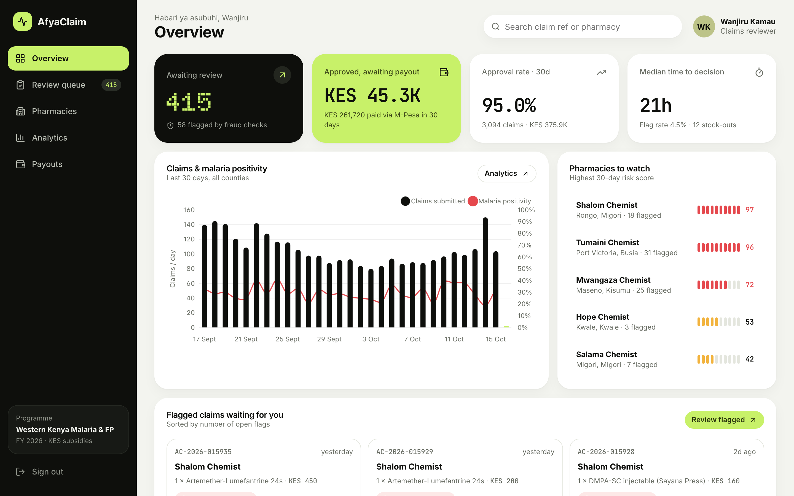

</div>

---

## Contents

- [Why it exists](#why-it-exists)
- [What's in the box](#whats-in-the-box)
- [Screenshots](#screenshots)
- [Architecture](#architecture)
- [How a claim flows](#how-a-claim-flows)
- [Fraud & quality checks](#fraud--quality-checks)
- [Offline-first sync](#offline-first-sync)
- [Payouts & the ledger](#payouts--the-ledger)
- [Quick start](#quick-start)
- [Testing](#testing)
- [Deploying to AWS](#deploying-to-aws)
- [Project docs](#project-docs)
- [Roadmap](#roadmap)
- [Contributing](#contributing)

## Why it exists

Subsidy programmes in East Africa pay community pharmacies to sell malaria tests, antimalarials and
contraceptives below cost, and then reimburse the difference. In practice that loop is paper and WhatsApp:

- Pharmacies wait **6–10 weeks** for reimbursement, which starves them of working capital.
- Ops teams can't tell a real rainy-season surge from a pharmacy inflating claims.
- Programme managers have no live view of stock-outs or test positivity, even though that data is an early outbreak signal.

AfyaClaim closes the loop. A pharmacist records a sale and attaches a claim in under 30 seconds, even with no
network. The claim reaches the back office with seven fraud and quality checks already run, and the reviewer
approves it with one keystroke. The payout goes out over M-Pesa. Every step is written to a tamper-evident audit trail.

## What's in the box

| Path | What | Stack |
|---|---|---|
| [`api/`](api) | Claims API: state machine, fraud engine, sync, ledger, M-Pesa B2C, nightly jobs | Rails 8.1 (API mode), PostgreSQL 16, Solid Queue, RSpec, OpenAPI 3 |
| [`dashboard/`](dashboard) | Back office: review queue, pharmacies, analytics, payouts | Vue 3, TypeScript, Pinia, Vue Router, Chart.js, Vitest |
| [`android/`](android) | Pharmacy POS: sales, stock, claims, offline sync | Kotlin, Jetpack Compose (M3), Room, WorkManager, Hilt, Retrofit |
| [`infra/`](infra/terraform) | AWS: VPC, ECS Fargate, RDS, S3, CloudFront, CloudWatch, GitHub OIDC | Terraform |
| [`.github/`](.github) | CI for each app, deploy pipeline, Terraform plans | GitHub Actions |
| [`docs/`](docs) | Spec, architecture, runbook, postmortem, design system | Markdown + Mermaid |

## Screenshots

### Back office (Vue)

<table>
  <tr>
    <td width="50%">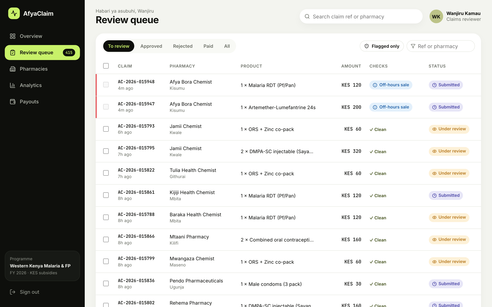<br /><sub><b>Review queue.</b> Status tabs, flag badges, bulk approve for clean claims, and <kbd>J</kbd>/<kbd>K</kbd>/<kbd>A</kbd>/<kbd>R</kbd> keyboard shortcuts.</sub></td>
    <td width="50%">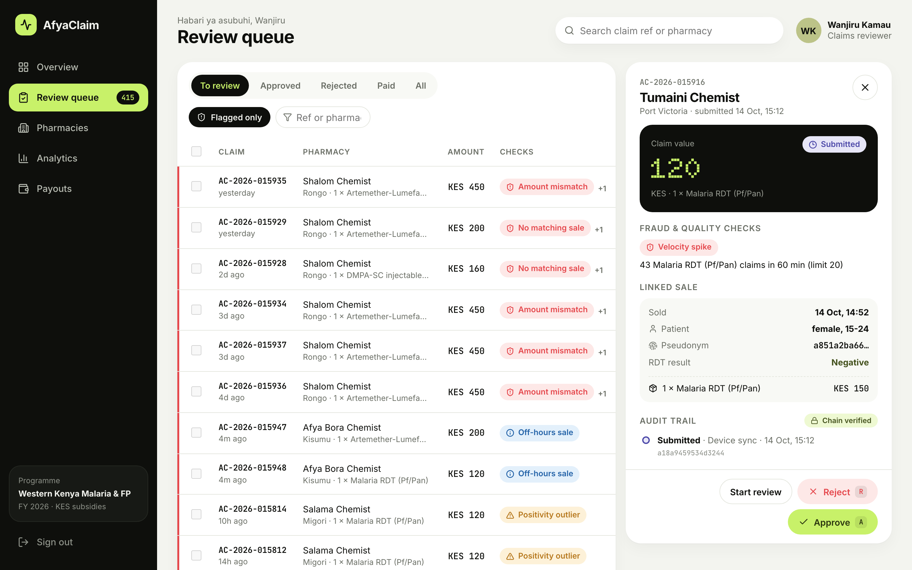<br /><sub><b>Flagged claim.</b> A velocity spike (50 malaria tests in an hour) blocks approval unless the reviewer overrides it with a note.</sub></td>
  </tr>
  <tr>
    <td>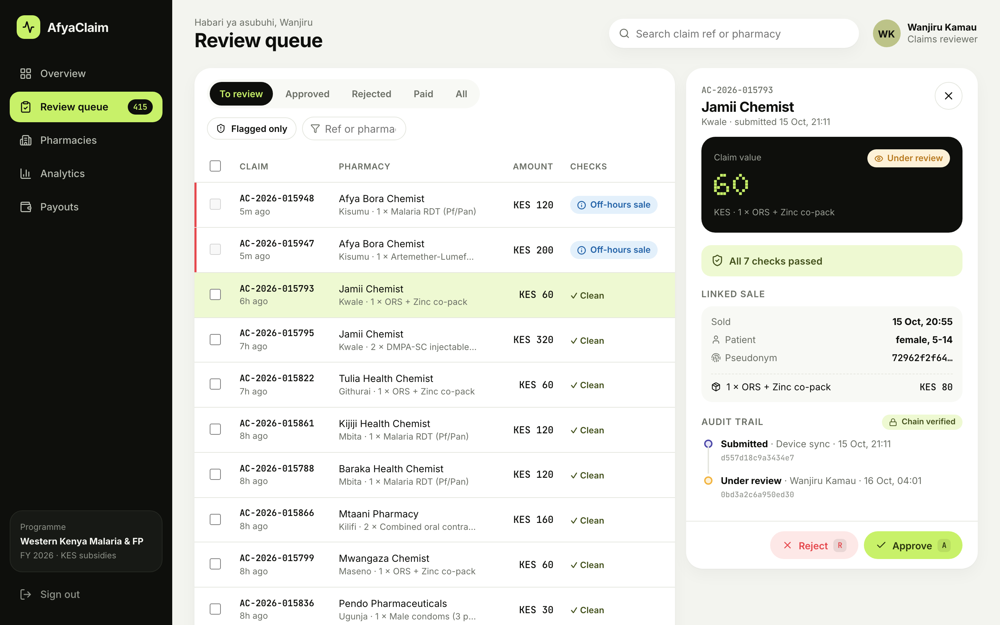<br /><sub><b>Clean claim.</b> Linked sale, pseudonymous patient and a SHA-256 hash-chained audit trail that is re-verified on every read.</sub></td>
    <td>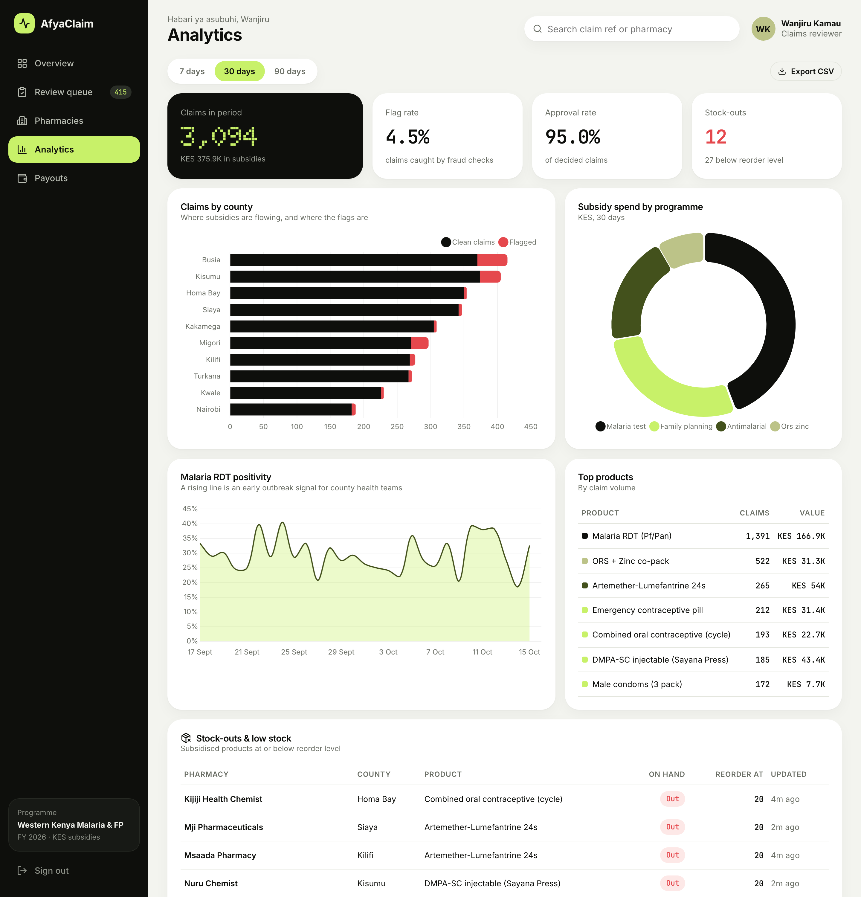<br /><sub><b>Analytics.</b> Claims by county, subsidy spend by programme, malaria RDT positivity and stock-outs.</sub></td>
  </tr>
  <tr>
    <td>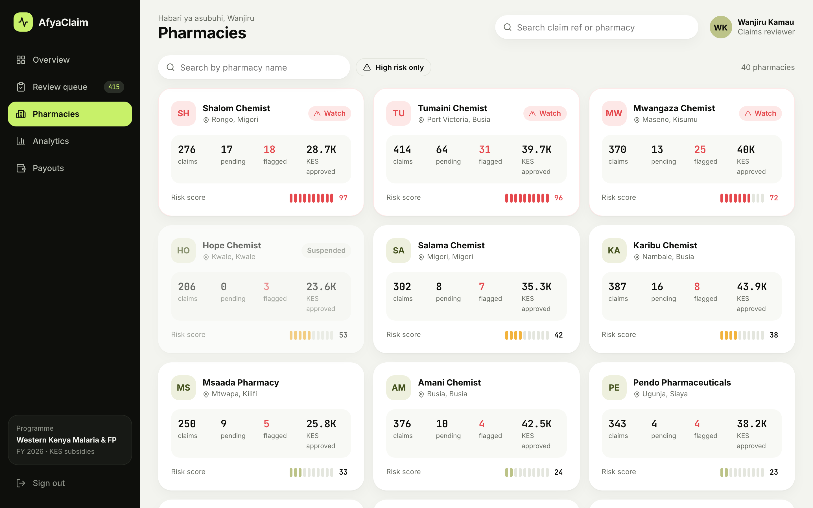<br /><sub><b>Pharmacies.</b> Sorted by a 30-day risk score built from unresolved flags.</sub></td>
    <td>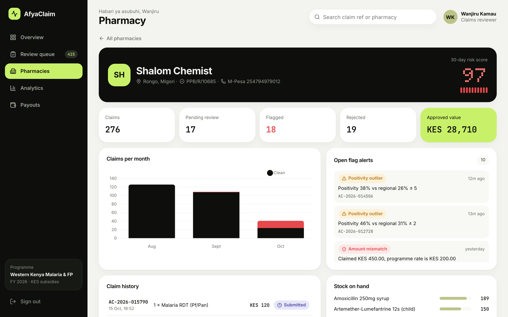<br /><sub><b>Pharmacy detail.</b> Monthly clean vs flagged claims, open alerts, claim history and stock on hand.</sub></td>
  </tr>
  <tr>
    <td>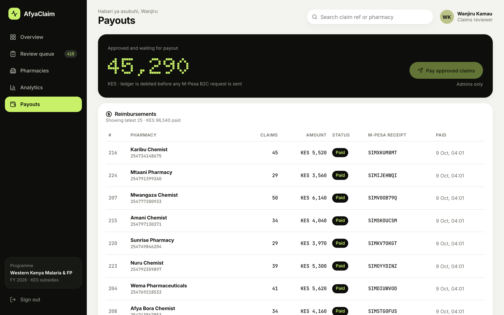<br /><sub><b>Payouts.</b> M-Pesa B2C reimbursements, with ledger-first accounting.</sub></td>
    <td>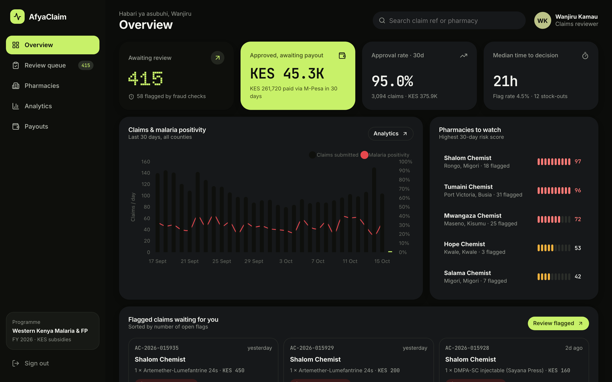<br /><sub><b>Dark mode.</b> Follows the operating system setting, with every token redefined.</sub></td>
  </tr>
</table>

### Pharmacy POS (Android)

<table>
  <tr>
    <td width="25%">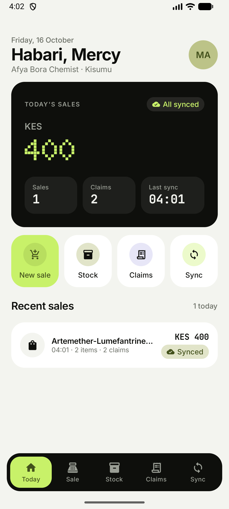</td>
    <td width="25%">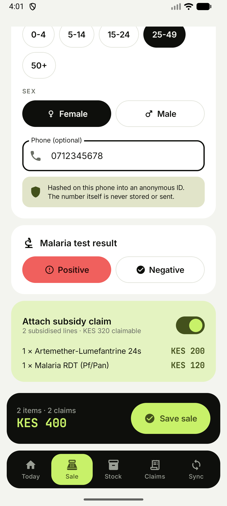</td>
    <td width="25%">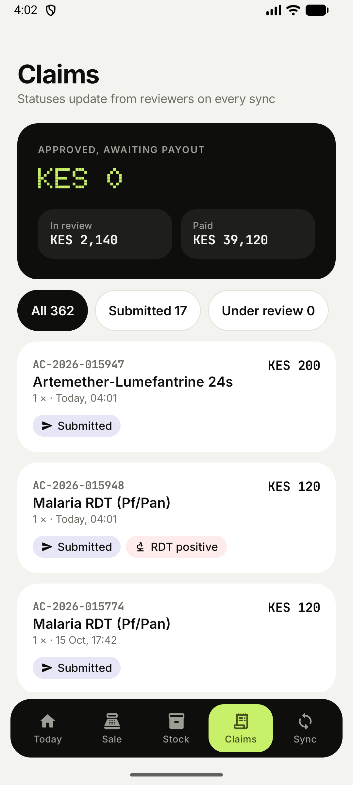</td>
    <td width="25%">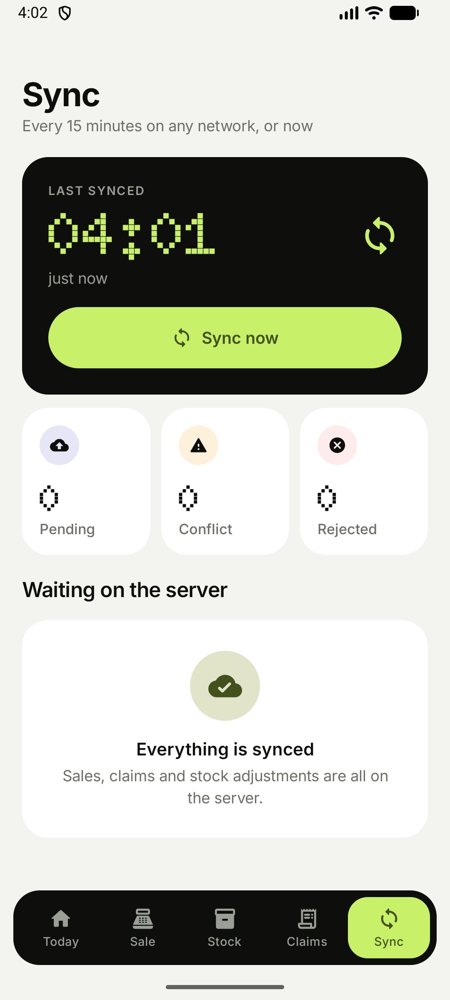</td>
  </tr>
  <tr>
    <td><sub><b>Today.</b> Sales total, pending-sync chip, quick actions.</sub></td>
    <td><sub><b>New sale.</b> Basket, patient age band and sex, RDT result, and the option to attach a subsidy claim.</sub></td>
    <td><sub><b>Claims.</b> Live status synced down from reviewers, including rejection reasons.</sub></td>
    <td><sub><b>Sync.</b> Pending, conflict and rejected records, with manual sync.</sub></td>
  </tr>
</table>

The visual language comes from eight health and wellness case studies: a single lime accent on ink-black hero
cards, calm off-white surfaces, 24px radii and dot-matrix numerals for the one number that matters on each
screen. See [`docs/design-system.md`](docs/design-system.md).

## Architecture

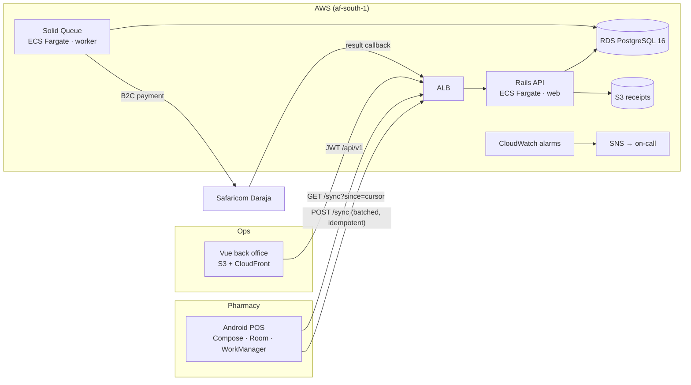

More diagrams, including the AWS deployment and the end-to-end sequence, are in [`docs/architecture.md`](docs/architecture.md).

## How a claim flows

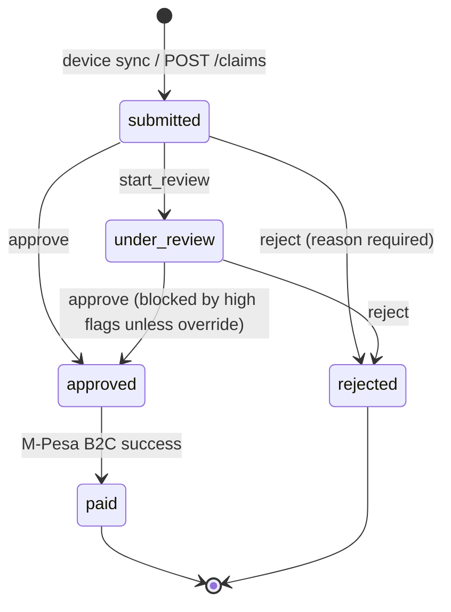

- All transitions go through `Claims::StateMachine`, which row-locks the claim and writes a `ClaimEvent` in the same transaction.
- Each event stores `digest = SHA256(prev_digest | payload)`. `GET /claims/:id` replays the chain and returns `audit_intact`, so an edit made directly in the database shows up in the UI as **Chain broken**.
- A failed payout reverses the ledger and returns the claims to `approved`, so they can go into the next batch.

## Fraud & quality checks

| Rule | Fires when | Severity | When it runs |
|---|---|---|---|
| `velocity` | More than 20 claims for one product from one pharmacy within 60 min (e.g. 50 malaria tests in an hour) | High | inline |
| `no_matching_sale` | The claim has no sale, or the sale doesn't cover the claimed quantity | High | inline |
| `amount_mismatch` | The amount ≠ programme subsidy × quantity | High | inline |
| `duplicate_patient` | Same pseudonymous patient and product within 7 days | Medium | inline |
| `stock_inconsistency` | Units claimed today exceed the day's opening stock | Medium | inline |
| `off_hours` | Sale recorded between 23:00 and 05:00 EAT | Low | inline |
| `positivity_outlier` | Pharmacy RDT positivity is more than 2σ above its county's over 14 days | Medium | nightly |

High-severity flags block approval. Each pharmacy's risk score (0–100) is a weighted count of unresolved
flags over 30 days. Rules are small classes in [`api/app/services/fraud/rules`](api/app/services/fraud/rules),
so adding one is a good first contribution.

## Offline-first sync

Connectivity in rural pharmacies is unreliable, so the POS writes everything to Room first.

1. Every sale, claim and stock adjustment gets a **UUID `client_uuid`** on the device. The server treats it as an idempotency key, so retries are always safe.
2. `SyncWorker` pushes pending rows in batches of 50 to `POST /sync`. Sales are applied before claims, so a claim can reference a sale from the same batch.
3. Each record comes back as `accepted`, `duplicate` (already received, mark as synced), `conflict` or `rejected`.
4. Stock moves as **relative deltas** (`-2 RDT`), not absolute counts, so two devices in the same pharmacy merge cleanly. The server wins for inventory. A delta that would go negative becomes a `conflict` and appears on the Sync screen.
5. `GET /sync?since=<cursor>` pulls the catalogue, inventory and claim status changes, so a rejection made in the back office shows up on the pharmacist's phone.

## Payouts & the ledger

```
Admin clicks "Pay approved claims"
  └─ per pharmacy, in one transaction:
       lock approved claims (FOR UPDATE SKIP LOCKED)
       create Reimbursement(idempotency_key = uuid)
       ledger: DEBIT programme_float / CREDIT payable:pharmacy:<id>   ← money is accounted for first
  └─ MpesaPayoutJob → Daraja B2C (OriginatorConversationID = idempotency_key)
  └─ result callback → DEBIT payable / CREDIT mpesa_clearing, claims → paid
                     ↘ failure → reversing entry, claims released for the next batch
NightlyReconciliationJob: ledger balances? paid ⇒ receipt? stuck > 2h ⇒ query status, never re-pay
```

This design comes from a [game-day postmortem](docs/postmortems/2026-07-14-payout-double-debit.md) in which a
retried job paid a pharmacy twice in the sandbox. Without Daraja credentials, payouts run in a clearly labelled
**simulated sandbox** mode, so the whole flow works locally.

## Quick start

**Prerequisites:** Ruby 3.3.5, Node 22, Docker. For the POS you also need JDK 17 and the Android SDK.

```bash
git clone https://github.com/cliff-gor/afyaclaim.git && cd afyaclaim
docker compose up -d db
```

```bash
cd api
bundle install
bin/rails db:prepare db:seed   # ~40 pharmacies, 75 days of claims, planted fraud patterns
bin/rails server               # http://localhost:3000 · API docs at /api-docs
```

```bash
cd dashboard
cp .env.example .env
npm ci && npm run dev          # http://localhost:5173
```

```bash
cd android
./gradlew installDebug         # emulator reaches the API at http://10.0.2.2:3000
```

| Role | Email | Password |
|---|---|---|
| Reviewer | `reviewer@afyaclaim.test` | `password123` |
| Admin (can run payouts) | `admin@afyaclaim.test` | `password123` |
| Pharmacist (POS only) | `pharmacist@afyaclaim.test` | `password123` |

Background jobs (fraud scan, reconciliation, reports, stock-out alerts) run with `bin/jobs`.

## Testing

| Suite | Command | What it covers |
|---|---|---|
| API | `cd api && bundle exec rspec` | 100 examples: models, state machine, every fraud rule firing and staying quiet, sync idempotency and conflicts, ledger and M-Pesa callbacks, jobs. **98% line coverage** (SimpleCov) |
| Dashboard | `cd dashboard && npm test` | Formatting, status and risk components, auth store |
| Android | `cd android && ./gradlew testDebugUnitTest` | 39 tests: sync reconciliation and engine (Robolectric + in-memory Room), pseudonym hashing, sale rules, money |
| Infra | `terraform fmt -check -recursive && terraform validate` | Both environments |

The OpenAPI 3 contract is at [`api/swagger/v1/openapi.yaml`](api/swagger/v1/openapi.yaml), and a running API renders it with Redoc at `/api-docs`.

## Deploying to AWS

The infrastructure is in [`infra/terraform`](infra/terraform): a VPC with private subnets, ECS Fargate (`web` runs
Puma and `worker` runs Solid Queue), Multi-AZ RDS PostgreSQL 16, private S3 for receipt photos, the dashboard on
S3 + CloudFront, and secrets in SSM Parameter Store. CloudWatch alarms cover 5xx rate, p95 latency, RDS
CPU and storage, queue latency, worker health, M-Pesa failures and `reconciliation_mismatch`.

```bash
cd infra/terraform/environments/staging
cp backend.hcl.example backend.hcl && cp terraform.tfvars.example terraform.tfvars
terraform init -backend-config=backend.hcl && terraform apply
```

Pushes to `main` deploy to staging through GitHub OIDC (no long-lived AWS keys). The pipeline builds the image,
runs migrations as a one-off ECS task, rolls `web` and `worker`, waits for them to stabilise, then publishes the
dashboard. Production deploys are a manual `workflow_dispatch` gated by a GitHub environment.

## Project docs

| Doc | |
|---|---|
| [Specification](docs/SPEC.md) | Problem, goals, domain model, API, sync, ledger, NFRs |
| [Architecture](docs/architecture.md) | System context, AWS deployment, sequence diagrams |
| [Runbook](docs/runbook.md) | Alarms, first response, deploy and rollback, DB restore |
| [Postmortem: payout double-debit](docs/postmortems/2026-07-14-payout-double-debit.md) | Blameless write-up of a simulated incident |
| [Design system](docs/design-system.md) | Tokens, type and the references behind them |
| [Contributing](CONTRIBUTING.md) | Setup, labels, review checklist, adding a fraud rule |

## Roadmap

- [x] Claims workflow with hash-chained audit trail
- [x] Seven fraud and quality rules plus pharmacy risk score
- [x] Offline-first Android POS with conflict handling
- [x] Analytics: county, product, positivity, stock-outs
- [x] M-Pesa B2C payouts with ledger-first accounting and nightly reconciliation
- [ ] Receipt photo upload from the POS (presigned S3 PUT)
- [ ] Positivity alerts pushed to county health officers
- [ ] Swahili localisation for the POS
- [ ] Per-programme subsidy rates and date-bounded programme periods

## Contributing

AfyaClaim is built in the open with the **Nairuby** and **Africa Ruby Community**. Issues labelled
[`good first issue`](https://github.com/cliff-gor/afyaclaim/labels/good%20first%20issue) are scoped for a first
PR, and reviews come back within 48 hours. Start with [CONTRIBUTING.md](CONTRIBUTING.md).

## License

[MIT](LICENSE) © Cliff Gor
