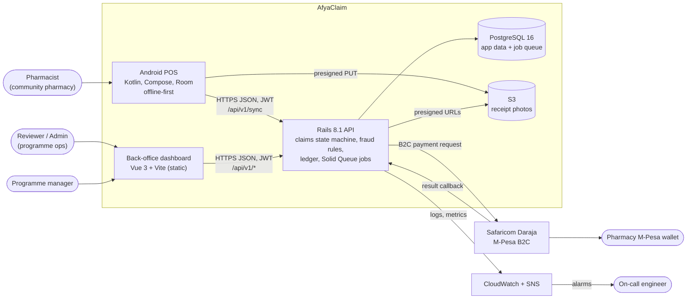
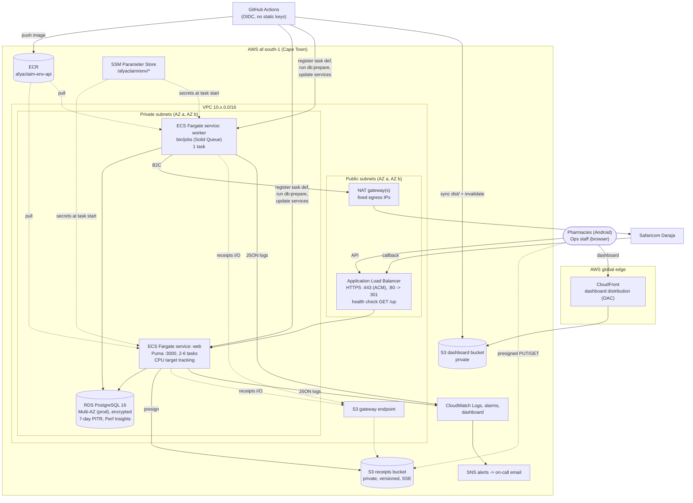
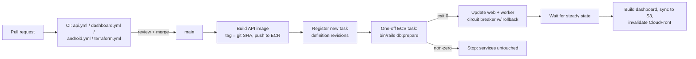
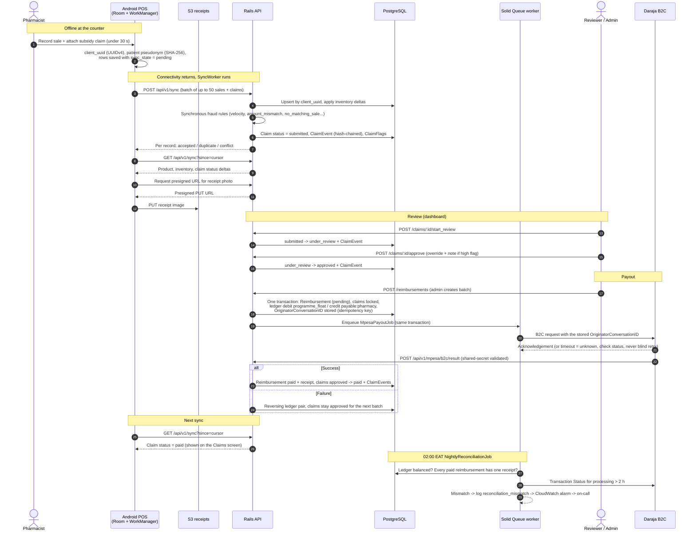

# AfyaClaim architecture

AfyaClaim lets community pharmacies record subsidised sales offline, submit subsidy claims, and get reimbursed
over M-Pesa after ops review. This page is the map; the details live in [SPEC.md](SPEC.md) (domain, API, rules),
[infra/terraform](../infra/terraform/README.md) (infrastructure) and the [runbook](runbook.md) (operations).

## 1. System context

Key properties:

- **Offline-first POS.** Every sale and claim gets a `client_uuid` on the device; the API treats it as an idempotency key, so sync retries are always safe.
- **Server owns status.** Devices create records; only the API changes a claim's status, via `Claims::StateMachine`, writing a hash-chained `ClaimEvent` for each transition.
- **One datastore.** PostgreSQL holds the app data *and* Solid Queue jobs: no Redis to run, and jobs can be enqueued in the same transaction as the data they act on.
- **No patient identifiers server-side.** Patients are a SHA-256 pseudonym computed on the phone.

## 2. AWS deployment

| Concern | Choice | Why |
|---|---|---|
| Region | `af-south-1` | Lowest latency to Kenya among AWS regions; data stays on the continent |
| Compute | ECS Fargate, two services from one image | No servers to patch; `web` scales on CPU, `worker` stays at one supervisor |
| Jobs | Solid Queue in PostgreSQL | Transactional enqueue, one fewer system to operate |
| Database | RDS PostgreSQL 16, Multi-AZ in production | 99.5% availability target; automated failover; point-in-time restore |
| Secrets | SSM Parameter Store SecureString | Injected by ECS at task start; never in images or Terraform outputs |
| Static UI | S3 + CloudFront with Origin Access Control | Bucket stays private; global edge, including African PoPs |
| CI/CD | GitHub Actions with OIDC roles per environment | Short-lived credentials; production deploys gated by environment reviewers |
| Observability | Lograge JSON -> CloudWatch Logs, metric filters, alarms -> SNS | Alarms map 1:1 to runbook sections |

Infrastructure is Terraform: modules `network`, `ecr`, `rds`, `s3`, `ecs`, `monitoring`, `iam`, composed by
`environments/staging` and `environments/production`. Terraform owns the task definition *shape*; the deploy
workflow owns the *image*.

### Deploy pipeline

## 3. Claim lifecycle: offline sale to payout

## 4. Failure modes designed for

| Failure | Behaviour |
|---|---|
| Phone offline for days | Records stay `pending` locally; sync later is idempotent on `client_uuid` |
| Two devices sell the same stock | Inventory is synced as deltas; a delta that would go negative is a `conflict`, surfaced on the Sync screen |
| A web task dies | ALB health check on `/up` removes it; ECS replaces it; autoscaling keeps capacity |
| Bad deploy | Migrations run first in a one-off task (failure stops the deploy); circuit breaker rolls back failed rollouts |
| Primary DB AZ fails | RDS Multi-AZ failover (~1-2 min of errors) in production |
| Daraja slow or times out | Outcome treated as unknown; status queried before any retry (see [postmortem](postmortems/2026-07-14-payout-double-debit.md)) |
| Ledger or payout drift | Nightly reconciliation pages on-call via `reconciliation_mismatch` |
| Tampering with claim history | `ClaimEvent` hash chain; `GET /claims/:id` reports `audit_intact` |
